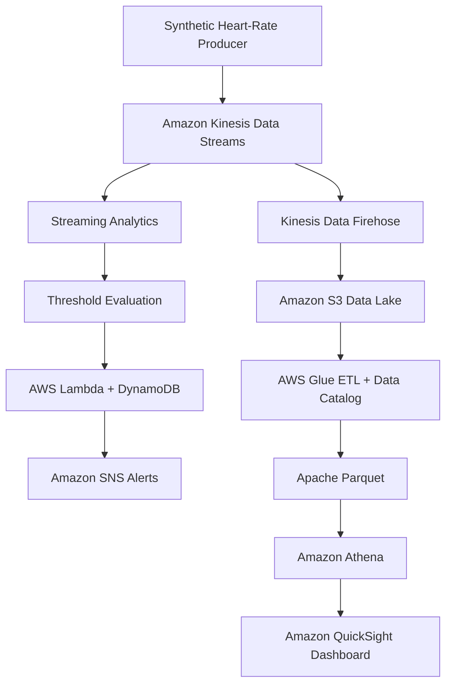

# AWS IoT Real-Time Health Monitoring & Serverless Data Lake

**AWS IoT | Amazon Kinesis | AWS Lambda | DynamoDB | Amazon S3 | AWS Glue | Amazon Athena | Amazon QuickSight | SQL | Bash**

## Project Overview

An AWS-based IoT streaming and data lake prototype designed to explore real-time physiological data monitoring, event-driven processing, and cloud analytics.

The project demonstrates how synthetic heart-rate measurements can be generated and prepared for ingestion into Amazon Kinesis. Its broader reference architecture illustrates how AWS services can support streaming analytics, threshold-based notifications, historical data storage, ETL processing, and business intelligence dashboards.

The prototype focuses on **streaming data engineering, cloud architecture, SQL analytics, and serverless data lake design**.

## Key Features

- **Synthetic IoT Data Generation:** Generate heart-rate events through a configurable Bash producer.
- **Real-Time Streaming Design:** Prepare data for ingestion into Amazon Kinesis Data Streams.
- **Streaming SQL Analytics:** Define per-device, 60-second average heart-rate calculations and threshold conditions.
- **DynamoDB Data Modeling:** Provide an example of device registration and contact configuration.
- **Offline Validation:** Preview generated events without connecting to AWS.
- **Serverless Data Lake Architecture:** Document an extended workflow involving Amazon S3, AWS Glue, Athena, and QuickSight.
- **Event-Driven Alerting Design:** Describe how AWS Lambda and Amazon SNS could support threshold-based notifications.

## Technology Stack

| Layer | Technologies | Role |
|---|---|---|
| Data Generation | Bash, JSON | Synthetic heart-rate events |
| Streaming Ingestion | Amazon Kinesis Data Streams | Cloud ingestion target |
| Streaming Analytics | Legacy Kinesis SQL | Historical windowed-aggregation example |
| Registration Data | Amazon DynamoDB | Example device/contact records |
| Event Processing | AWS Lambda, Amazon SNS | Reference alerting architecture |
| Data Storage | Amazon S3, Kinesis Data Firehose | Reference data lake ingestion |
| Data Transformation | AWS Glue, Apache Parquet | Reference ETL and columnar storage |
| Query Engine | Amazon Athena, SQL | Reference analytical querying |
| Visualization | Amazon QuickSight | Reference dashboard architecture |

AWS Lambda, SNS, Glue, Athena, QuickSight, and the complete data lake are documented architecture components, not verified deployed implementations in the supplied repository.

## System Architecture



*Conceptual end-to-end architecture. The supplied code implements a synthetic producer, legacy streaming SQL, and example registration data. The other stages require separate implementation and deployment.*

## Streaming Data Processing

### 1. Synthetic Heart-Rate Generation

The Bash producer simulates physiological measurements that can be used to test data ingestion workflows.

The producer supports configurable record counts and an offline preview mode, allowing events to be inspected without using AWS resources.

### 2. Stream Processing and Windowed Aggregation

The repository includes a legacy SQL example that calculates a rolling 60-second average per device and applies a heart-rate threshold.

This demonstrates core streaming analytics concepts:

- Event ingestion
- Per-device grouping
- Time-window aggregation
- Threshold evaluation
- Structured analytical output

The original design uses Kinesis Data Analytics for SQL applications, a discontinued AWS service. The SQL is retained as an educational example and is not presented as a currently deployable application.

### 3. Device Registration and Enrichment

A DynamoDB registration example represents device and contact information that could be used to enrich incoming physiological events.

The extended architecture proposes using AWS Lambda to combine streaming measurements with registration data before evaluating notification rules.

### 4. Serverless Data Lake Design

The historical architecture describes storing streaming records in Amazon S3 and using AWS Glue to transform JSON records into compressed Apache Parquet datasets.

Amazon Athena can then query cataloged data using SQL, with Amazon QuickSight serving as the visualization layer.

These components illustrate how a real-time ingestion workflow could be extended into a historical analytics platform.

## Local Setup and Execution

### Prerequisites

- Bash
- Python 3 for JSON validation
- AWS CLI v2 for optional cloud ingestion
- An existing Kinesis Data Stream for live sending
- Configured AWS credentials and permissions

### 1. Generate Synthetic Events Locally

```bash
COUNT=10 bash kinesis_client_HeartRate.sh --dry-run
```

This previews ten synthetic events without sending data to AWS.

### 2. Validate the Bash Script

```bash
bash -n kinesis_client_HeartRate.sh
```

### 3. Validate the Registration JSON

```bash
python3 -m json.tool registration.example.json
```

### 4. Send Events to an Existing Kinesis Stream

```bash
STREAM_NAME=your-existing-stream \
AWS_REGION=us-east-1 \
COUNT=10 \
bash kinesis_client_HeartRate.sh --send
```

This command intentionally sends records to AWS. It requires valid credentials, an existing stream, and appropriate permissions. AWS charges may apply.

## Repository Structure

```text
aws-iot-heart-rate-streaming/
├── kinesis_client_HeartRate.sh
├── DESTINATION_SQL_STREAM.sql
├── registration.example.json
├── ARCHITECTURE_HISTORY.md
├── ATTRIBUTION.md
├── AUDIT.md
├── LICENSE
└── README.md
```

This structure lists the main files identified in the supplied cleaned README. Additional assets may exist in the actual repository.

## Validation and Testing

The prepared project has undergone the following reported checks:

| Validation | Result |
|---|---|
| Bash script syntax | Passed |
| Offline synthetic data generation | Passed |
| JSON registration validation | Passed |
| Live Kinesis ingestion | Not verified |
| Legacy streaming SQL execution | Not verified |
| AWS Lambda and SNS integration | Not supplied |
| AWS Glue and Athena integration | Not supplied |
| QuickSight dashboards | Not verified |
| End-to-end cloud deployment | Not verified |

The prototype is suitable for studying streaming data generation and cloud analytics architecture, but it is not a production-ready medical monitoring application.

## Historical Data Lake Analysis

The original reference materials describe an Athena comparison in which a query scanned approximately 205 KB of raw data versus 4.99 KB of Parquet data.

These figures are **historical reference results**, not measurements reproduced during the current validation.

They illustrate the potential efficiency benefits of columnar storage, although actual query performance and cost depend on dataset size, compression, partitioning, and workload.

## Future Enhancements

- Migrate legacy streaming SQL logic to a supported Apache Flink implementation.
- Implement AWS infrastructure using Terraform or AWS CloudFormation.
- Add an AWS Lambda enrichment and alerting pipeline.
- Configure Amazon S3 storage and AWS Glue ETL jobs.
- Build Athena queries and QuickSight dashboards.
- Introduce automated integration tests and monitoring.
- Evaluate real sensor ingestion with appropriate data-quality controls.
- Add secure configuration management and cost monitoring.

## Project Scope and Limitations

This repository is an educational data engineering prototype.

It does not include a fully deployed AWS environment, live medical sensor integration, validated concussion detection, or clinically approved alert thresholds.

Any physiological thresholds used in examples are illustrative and should not be used for medical diagnosis or emergency decision-making.

## Documentation and Attribution

- `ARCHITECTURE_HISTORY.md` contains the historical architecture walkthrough and reference materials.
- `AUDIT.md` documents validation findings and implementation limitations.
- `ATTRIBUTION.md` records the original source and contributor attribution.
- `LICENSE` contains the applicable Apache License 2.0 terms.

The project includes work prepared for maintenance under [ds2204](https://github.com/ds2204). Original source attribution and licensing requirements are preserved.

---

**Project Focus:** Cloud Data Engineering | IoT Streaming | AWS Architecture | Serverless Data Lakes | SQL Analytics

**GitHub:** [ds2204](https://github.com/ds2204)
